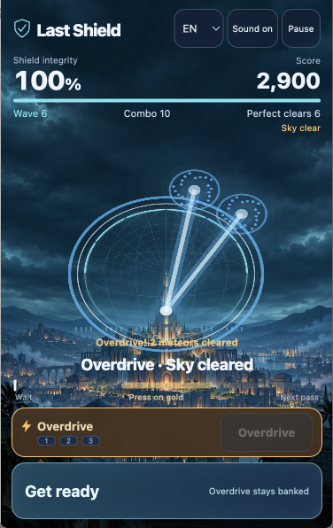
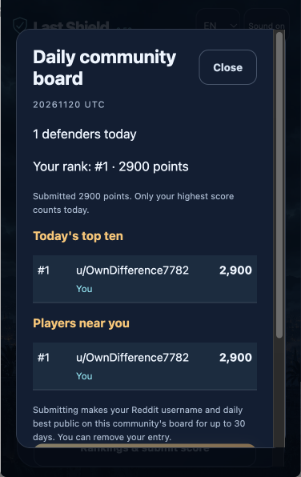

# Last Shield

**One daily storm. A city to defend. A community score to beat.**

Catch the gold, hold your beam, and defend Neo Babylon against an escalating meteor storm. Everyone faces the same daily sequence. Learn when to switch targets, save Overdrive for the right moment, then see how your best run ranks in your Reddit community.

## Play on Reddit

Open the [playable Reddit post](https://www.reddit.com/r/last_shield_dev/comments/1xwkbkk/last_shield_daily_meteor_defense/) and choose **Start defending**. The game runs inside Reddit; no external game website is required.

- [Watch v0.50 Reddit gameplay](https://github.com/mkhsu2002/Last-Shield/blob/main/docs/demo/v0.50/last-shield-v0.50-reddit-gameplay.mp4)
- [Devvit app listing](https://developers.reddit.com/apps/last-shield)
- [Public test community](https://www.reddit.com/r/last_shield_dev/)
- [Source repository](https://github.com/mkhsu2002/Last-Shield)

## The daily defense

- **A fresh storm each day.** A new UTC day brings a new meteor sequence. Same-day replays give you a chance to learn the pattern and improve your decisions.
- **Timing with consequences.** A perfect beam stops its selected meteor while the others keep falling. Release after the clear, choose the next threat, and chain the gold relay.
- **An emergency move you control.** Bank three perfect clears, then spend Overdrive when the sky becomes too crowded.
- **Your community's daily board.** Submit your best run to see the top ten, the players near you, and the score needed to pass the next defender. Tied scores share a rank.
- **Strategies worth discussing.** Preview your result, add an optional note about your run, and bring the conversation back to the Reddit post.

New in **v0.50**: a painted Neo Babylon skyline, textured meteors, blue-white Overdrive beams, and stereo impact effects bring the defense to life. Timing practice gives you room to see your result and choose when to continue.

New in **v0.49**: a clearer battlefield and a bottom fire control keep the defense within reach on smaller screens. Overdrive stays compact as your charge changes.

New in **v0.48**: community rankings, scores recalculated from gameplay before ranking, and score-and-strategy sharing. You can play without logging in; joining the board is your choice.

## Inside the Reddit game

| Defend the city | Compare your daily best |
| --- | --- |
|  |  |

Both images show v0.50 running inside the Reddit game. The video linked above shows v0.50 timing practice, blue-white Overdrive beams, a completed run, and the community board.

## How to play

1. **Press on gold.** When the ring turns gold, press and hold to catch the meteor with a perfect 3× beam. Keep holding until it shatters.
2. **Release, then press for the next.** A perfect clear opens a short gold relay for the next meteor. The progress bar shows when to keep holding; release only after the clear.
3. **Save your Overdrive.** Three perfect clears fill your charge. Press **Overdrive** or **E** to clear all incoming meteors. A full charge stays banked until you choose to use it.

Missed the timing? Gold returns every second. Release and retry; damage already dealt stays. A perfect beam stops its target while you hold it, while other meteors keep moving. You can hold a specific meteor to choose a different target.

Your shield starts at 100%. Smaller, partly destroyed meteors deal less damage. Survive increasingly crowded waves until the shield falls, then try to beat your daily best.

## Controls and languages

- **Phone or tablet:** hold the fire button or a meteor; tap Overdrive when charged.
- **Keyboard:** hold **Space** to fire, **E** for Overdrive, and **Esc** to pause or resume.
- Use the sound control to mute or enable audio. The game respects reduced-motion preferences.
- English is the default. Switch to **繁中** in the header for Traditional Chinese; the game remembers your choice when device storage is available.

Try **Practice perfect timing** before starting the daily challenge.

## Scores and privacy

Your daily best and language choice are saved on your device when storage is available. The game remains playable without storage or a Reddit login.

In the Reddit game, choose **Rankings & submit score** after a run to enter the daily board for the current subreddit. The board shows the top ten, players near you, and the points needed to pass the next defender. Each account keeps its highest accepted score per UTC day and rules version; ties share a rank. Starting a run does not publish your score. Submitting makes your Reddit username and score public on that community's board. You can remove your entry for a day. Records expire within 30 days of the challenge day's start. Submit within two hours of starting a run. Practice and the standalone web preview keep local scores only.

Use **Share score & strategy** to preview your result and optionally add a strategy note. Copy the text, then open the Reddit post to paste, edit, and send your own comment. Nothing is posted automatically.

## Daily challenge and replay

The meteor sequence is seeded by the UTC day. Replays on the same day use the same sequence, so players can learn routes and compare strategies. A run keeps the day it started with, even across midnight. A new UTC day brings a new sequence.

Pressure grows from individual meteors to volleys of up to six simultaneous targets. A perfect beam stops only its selected target; the others keep approaching. Partly melting a meteor reduces its eventual impact damage. Choosing your next target and deciding when to spend Overdrive matter as the sky fills.

After a run, share the choices that helped you survive: when did you use Overdrive, and which target did you clear first? The same daily sequence gives players a common challenge to discuss. You can also copy just your result and game-post link to invite a friend.

## For community moderators

After installing Last Shield, open your community menu and choose **Create a Last Shield game post** to create a playable post. Players open the post and select **Start defending** to play.

## Terms and privacy

Read the [Terms and Conditions](https://last-shield.vercel.app/terms/) and [Privacy Policy](https://last-shield.vercel.app/privacy/) for Last Shield.

## Credits

Last Shield is set in the original Neo Babylon world. Rights to the original world, characters, artwork and audiovisual assets remain with their creators.

## Current release

Game version **v0.50**, Devvit package **0.50.0**. The public test post is free to play, with no app purchase, invite list, or game usage limit. It will remain available for hackathon judging through **December 16, 2026 at 6:00 p.m. PST**. Reddit may apply its own security checks.

For development and release information, see the [development notes](docs/development.md).
