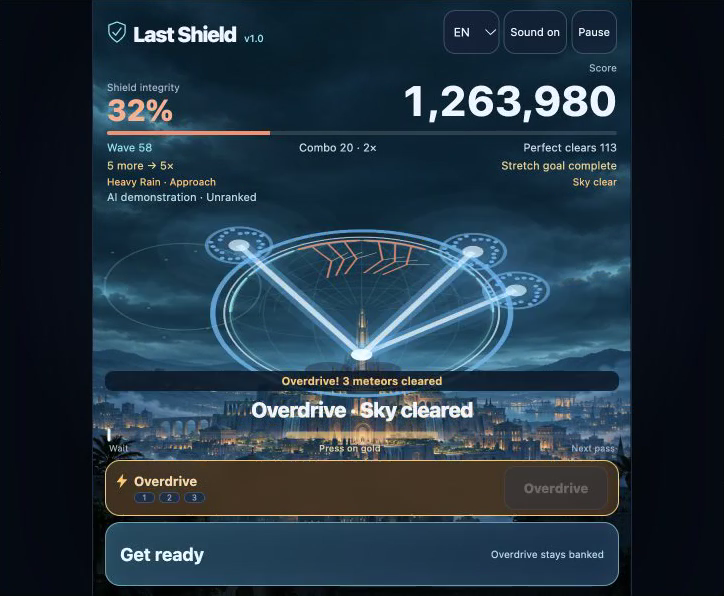
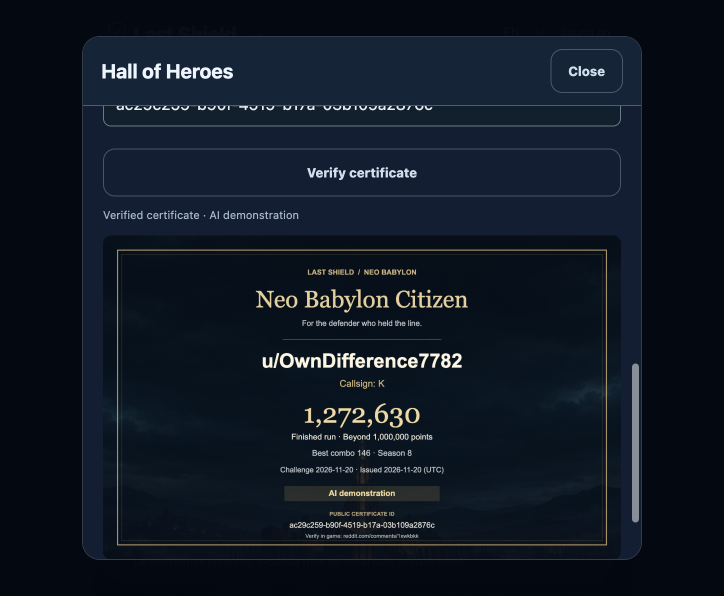

# Last Shield v1.02

**A daily meteor defense game built around Reddit rivals and lasting records.**

Defend Neo Babylon inside a Reddit post. Catch the gold, hold until the meteor shatters, then release and choose the next threat. Build a long combo, bank Overdrive for a crowded sky, and challenge your community to do better.

[**Play today’s defense**](https://www.reddit.com/r/last_shield_dev/comments/1xwkbkk/last_shield_daily_meteor_defense/) · [Watch gameplay](https://www.youtube.com/watch?v=mBaIPLJZBs8) · [Devpost project](https://devpost.com/software/last-shield)

## Why come back tomorrow?

Every UTC day brings a shared meteor sequence and a rotating storm: a longer gold relay, faster crossing cores, or a heavier sky. Today’s basic and stretch goals give you a clear target beyond the score. Learn the pattern, change your approach, and try again while everyone faces the same challenge.

The opening screen shows the reset countdown and tomorrow’s storm. On the same device, daily focus progress remembers your best single run across weaker replays. The daily board gives each defender a fresh chance; the Hall preserves daily champions and longer-term records within the current scoring season.

## Turn a good run into a record

| Record | What counts |
| --- | --- |
| Daily community board | Your highest submitted score for the UTC day; top ten, nearby rivals and the gap to the next defender |
| Daily champions | The leading score for each day, with ties; results settle after the late-submission window |
| Score Top 100 | Each enrolled defender’s highest score in the current season |
| Combo Top 100 | Each enrolled defender’s longest combo, ranked separately from score |
| Million-Point Heroes | A verified finished run strictly above **1,000,000** points unlocks a **Neo Babylon Citizen card** |

The battlefield shows today’s leading defender and score. After a run, see where your longest chain broke and get a concrete target for the next attempt. Scores are recalculated from gameplay on the server before entering a board. Tied scores share a rank.

Joining the daily board and leaving a longer-term Hall record are separate choices. Hall enrollment lets you add a callsign alongside your Reddit name and share a checkable Citizen card.

## Give a friend a score to chase

1. **Finish and submit.** Choose **Invite a friend** in Rankings to copy your challenge code and the game link.
2. **Accept a real target.** Your friend pastes the code into **Accept a friend’s challenge**. The game checks your current public best and brings that score into their next run.
3. **Bring back a better run.** Share the score and a strategy: the relay you kept alive, the core you chose first, or the wave where Overdrive saved you.

A shared daily storm makes these comparisons meaningful. Older invitations offer today’s challenge, and unavailable records cannot be accepted. Reddit sharing is supported where the client allows it, with a copyable code and link as the dependable path. A dedicated social preview helps the game stand out when the public post is shared.

Million-point defenders can share their Citizen card and verification ID. Images can be exported separately, while the in-game lookup lets recipients check the achievement. Nothing posts a message or comment on your behalf.

## How to play

- **Press on gold and keep holding.** A perfect start creates a 3× beam and stops its selected meteor. Other threats keep falling.
- **Release after the shatter.** Press again for the next target. Perfect clears open a short gold relay; gold also returns each second if you miss the timing.
- **Save your emergency move.** Three perfect clears fill Overdrive. Press **E** or tap **Overdrive** when you want to clear the sky.

Long combos multiply the points awarded for each clear:

| Combo | 1–9 | 10–24 | 25–49 | 50–74 | 75–99 | 100+ |
| --- | ---: | ---: | ---: | ---: | ---: | ---: |
| Points multiplier | 1× | 2× | 5× | 10× | 25× | 50× |

An impact resets the combo. Partly melting a meteor reduces its impact damage. Hold a specific meteor to choose your target; a held beam does not automatically jump to another core.

**Practice defense** offers three optional lessons: perfect timing, release-and-press relay, and saving Overdrive for danger. Each ends with feedback you can read before continuing.

## A taller sky on every screen

The battlefield keeps its proportions as the window changes. On phones, meteors enter below the status display and approach the shield from the upper sky. Wider screens place status and controls beside the city, leaving the flight path clear.

## Gameplay recording (v1.0)

Recorded in v1.0; the current game uses the adaptive layout above.

| Overdrive clears the sky | A place in the Hall |
| --- | --- |
|  |  |

## Controls and access

- **Touch:** hold the fire button or a meteor; tap Overdrive when charged.
- **Keyboard:** **Space** to fire, **E** for Overdrive, **Esc** to pause or resume.
- English and Traditional Chinese, sound control, and reduced-motion support are available.
- Play without signing in. Sign in to Reddit when you want to submit a score or join the Hall.

A run keeps the UTC day it started with, even across midnight. Submit within two hours of starting. Device storage keeps up to seven played days of local bests and daily focus progress when available; this is not synced account history. Daily records expire within 30 days, while opted-in Hall records remain during the current season while enrolled.

## For community moderators

Install [Last Shield](https://developers.reddit.com/apps/last-shield), then choose **Create a Last Shield game post** from your community menu. Players select **Start defending** in that post. Rankings belong to that subreddit.

## Development

Built with Devvit Web, TypeScript, Phaser, Vite, Hono, Web Audio and Reddit Redis. The client and server share deterministic game rules; submission retries are idempotent. See [development notes](docs/development.md) and the [v1.02 release record](docs/v1-02-mobile-launch-2026-11-20.md).

[Source](https://github.com/mkhsu2002/Last-Shield) · [App listing](https://developers.reddit.com/apps/last-shield) · [Community](https://www.reddit.com/r/last_shield_dev/)

## Credits and sharing choices

Last Shield takes place in the original Neo Babylon world. Rights to its world, characters, artwork and audiovisual assets remain with their creators.

The million-point video features K, an AI-controlled demonstration, shown at 3× speed with stereo game audio. Demonstration runs are labeled and excluded from competitive boards and personal daily achievements. AI tools assisted implementation and testing.

Submitting a score makes your Reddit name and score visible on that community’s daily board. Hall membership requires a separate choice; you can remove your display and revoke your Citizen card. Public image export also requires agreement because shared copies may remain after withdrawal. The card is an in-game achievement, not legal citizenship or a financial asset.

[Privacy Policy](https://last-shield.vercel.app/privacy/) · [Terms and Conditions](https://last-shield.vercel.app/terms/)
